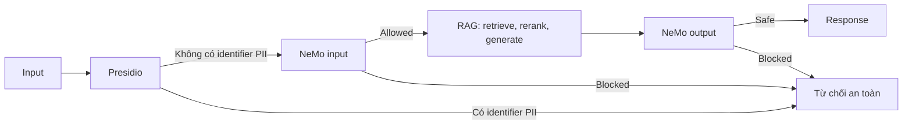

# Blueprint CI/CD cho RAG và guardrails

Nhóm: Sodeep.

Người phụ trách: Trần Kim Phương — 2A202602565

Đây là **đề xuất kiến trúc, CI/CD và monitoring**, chưa triển khai thành
workflow hay dịch vụ production. Bằng chứng đã có là các batch A/B/C và kiểm
tra offline.

| Phase / nguồn | Run timestamp UTC | Models theo vai trò |
|---|---|---|
| A — [ragas_50q.json](../../artifacts/ragas_50q.json) | 2026-10-12T05:17:33.438949+00:00 | generation: `gpt-6-luna`; evaluator: `BAAI/bge-m3`, `gpt-6-luna` |
| B — [judge_results.json](../../artifacts/judge_results.json) | 2026-10-12T05:16:36.812714+00:00 | generation nguồn A: `gpt-6-luna`; judge: `gpt-6-luna` |
| C — [guard_results.json](../../artifacts/guard_results.json) | 2026-10-12T08:16:42.104370+00:00 | guard: `gpt-6-luna`; generation/evaluator/judge không chạy trong batch C |

Model IDs lấy từ `metadata.models` từng artifact, không dùng judge thay
evaluator. Timestamp C tương ứng 15:16:42 ngày 12/10/2026, Asia/Ho_Chi_Minh.

## Kiến trúc và failure action

Luồng request đề xuất:

Presidio quét `VN_CCCD` (CCCD/CMND), `VN_PHONE`, `PHONE_NUMBER` và
`EMAIL_ADDRESS`; anonymizer giữ loại entity/vị trí và tạo bản redact.
Phạm vi nằm trong `PII_ENTITIES` của `src/phase_c_guard.py`. Không dùng English
NER để chặn mọi nhãn PERSON trên tiếng Việt. NeMo input kiểm tra yêu cầu dữ
liệu cá nhân, giả mạo quyền hạn, jailbreak, prompt injection và nội dung ngoài
HR/IT policy; quyết định không dựa vào category/expected của fixture hay từ
“xin lỗi/không thể”.

RAG đề xuất dùng m1 chunking, m2 hybrid search trên corpus/Qdrant, m3 rerank,
m5 enrichment khi cấu hình yêu cầu và generation từ contexts. m4 RAGAS và
Phase B judge chạy ngoài đường xử lý request để đánh giá. Giữ chính sách cũ
và mới, dùng metadata phiên bản/hiệu lực để chọn tài liệu hoặc so sánh khi hỏi.

Request dừng sớm khi Presidio hoặc NeMo input chặn; batch input hiện tại cũng
short-circuit, khác phép đo Task 12 luôn chạy cả hai tầng. NeMo output kiểm
tra answer có sẵn: cases 201/202 giữ nguyên answer sạch, 203/204 thay answer
nhạy cảm bằng refusal. Email helpdesk công ty trong case 202 được phép ở output.

| Tình huống | Failure action đề xuất | Bằng chứng / phạm vi |
|---|---|---|
| Input có identifiers | Không gọi RAG; refusal không lặp lại PII | Presidio và short-circuit đã có trong batch input |
| Input vi phạm policy | Không gọi RAG; refusal từ rail | `check_input_rail`, quyết định từ activated rails |
| Output bị chặn | Thay answer bằng refusal, không trả bản nhạy cảm | Cases 203/204 trong artifact C |
| Guard lỗi/timeout | Fail closed: báo tạm thời không xử lý được; không bỏ qua guard; ghi error code/cảnh báo | Cần triển khai timeout/error handling trong dịch vụ request |
| Retrieval rỗng/thiếu bằng chứng | Nêu chưa đủ thông tin hoặc hỏi thêm; không đoán hay dùng ground truth làm answer | Đề xuất; cần phân biệt thiếu bằng chứng với lỗi suy luận |
| Generation lỗi | Fallback chỉ khi có context liên quan và output rail xác nhận safe; nếu không, báo chưa đủ thông tin | Lab setup có `extractive_fallback`, model=null; 50 answers hiện tại đều `llm`, chưa kiểm chứng fallback production |

Secrets giữ trong `.env` ở máy chạy hoặc secret store CI, không commit key,
`.env`, cache hay virtualenv. Log đề xuất chỉ giữ request ID, model/config/code
version, quyết định rail, loại entity, latency và error code; không ghi raw
PII, credentials, toàn bộ prompt/context hay answer bị chặn. Mẫu điều tra phải
redact trước khi lưu, hạn chế quyền truy cập và xóa sau 7 ngày (đề xuất).

## Phạm vi và số đo latency

Task 12 đã đo **`input_layers_sequential`**: Presidio rồi NeMo input, không
short-circuit kể cả khi phát hiện PII. Engines tạo trước đo; **2 warm-up thật**
bị loại. Có **20 timed samples**, cycling 8 clean inputs, `perf_counter`,
đơn vị ms, `percentile_method=linear`.

Percentile nội suy tại `(n-1)*q`. `input_guard_ms` là tổng hai tầng từng sample
trước khi tính percentile, không cộng P95 riêng. Bảng làm tròn 3 chữ số;
raw samples và số gốc nằm trong `guard_results.json`.

| Layer / scope | P50 ms | P95 ms | P99 ms | Tình trạng |
|---|---|---|---|---|
| Presidio | 9.881 | 33.244 | 56.049 | Đã đo Task 12 |
| NeMo input | 3293.719 | 4712.893 | 6128.257 | Đã đo Task 12 |
| Input guard sequential | 3314.328 | 4722.166 | 6140.152 | Đã đo Task 12 |
| RAG | chưa đo | chưa đo | chưa đo | Ngoài phạm vi bắt buộc |
| NeMo output | chưa đo | chưa đo | chưa đo | Ngoài phạm vi bắt buộc |
| Full guard / short-circuit request | chưa đo | chưa đo | chưa đo | Không suy từ `input_guard_ms` |

Input-layer budget target **500 ms**; P95 **4722.165693 ms**,
`latency_budget_ok=false`, khoảng 9.44 lần target. NeMo input là bottleneck
(P95 4712.892509 ms); chưa có tracing để tách model inference, network và
provider queue. Vượt budget vẫn là phép đo lab hợp lệ, cần cải thiện hiệu năng.

Kế hoạch bổ sung: reuse engines/client trong cùng event loop, warm-up 2 request,
rồi thu ít nhất 100 request cho mỗi nhóm allowed, PII-blocked,
NeMo-input-blocked và output-blocked. Ghi UTC timestamp, `perf_counter`
đầu/cuối từng stage/toàn request, code/config/model version, concurrency và
timeout; loại warm-up. Tính RAG, output rail, full guard và end-to-end riêng,
phân nhóm đường đi short-circuit; stage không chạy không được gán 0 để tính
percentile. Full guard chỉ tính các tầng bảo vệ thực sự chạy; tổng request
còn gồm RAG và orchestration. P99 từ 20 samples chỉ mô tả batch nhỏ.

## CI gates đề xuất

| Gate | Ngưỡng đề xuất | Baseline hiện tại |
|---|---|---|
| Source/schema/contract + offline tests | Checker/tests exit 0, đúng sources | Artifacts A/B/C hợp lệ; TEAM cần hoàn thiện để checker toàn repo đạt |
| RAGAS đúng 50 câu | Overall faithfulness ≥0.75; avg_score ≥0.65 | 0.8039 / 0.8023: đạt |
| Judge calibration | κ >0.60 trên đúng 10 supplied answers; giữ swap và phân tích bất đồng | κ=0.80; position inconsistency 0/5: đạt trên bộ nhỏ |
| Input/output safety | Attacks ≥18/20; clean 8/8; outputs 4/4 đúng, output sạch giữ nguyên | 20/20, 8/8, 4/4: đạt |
| Input-layer performance | Sequential input P95 <500 ms | 4722.166 ms: không đạt |
| Full guard performance | Full guard P95 <500 ms sau phép đo đúng scope | Chưa đo; chưa đủ bằng chứng thông qua gate |

Overall mean tính trên từng câu, có trọng số theo counts 20/20/10, không lấy
trung bình đều ba distribution means. Mốc bắt buộc lab vẫn attacks ≥15/20;
≥18/20 kèm clean controls đạt là mốc bonus/CI đề xuất. Đạt trên fixtures
không tự chứng minh sẵn sàng production.

CI đề xuất chạy `python scripts/check_lab.py --with-tests`, sau đó kiểm tra
các quality/performance thresholds trong bảng từ artifacts; job trả nonzero
nếu gate không đạt để chặn rollout. Checker hiện chỉ kiểm tra hợp đồng bài
nộp/tests, chưa thay các quality gates bổ sung. Baseline chưa đạt input P95;
full guard cần đo riêng trước khi đánh giá gate production.

Workflow này chưa triển khai. Batch live chỉ chạy khi cần cập nhật bằng chứng:
sửa RAG thì sinh lại answers và chạy A/B; sửa guard thì chạy C. Giữ đúng nguồn,
model IDs và hashes; lưu secrets trong CI secret store. Safety fail thì chặn
rollout hoặc rollback, không bỏ guard để giảm latency.

## Monitoring và cải tiến

Baseline từ A/B/C:

- RAGAS overall avg_score **0.8023**; faithfulness **0.8039**, answer_relevancy
  **0.8438**, context_precision **0.8817**, context_recall **0.6800**.
- Distribution means: factual **0.9170**, multi_hop **0.7283**, adversarial
  **0.7211**. Adversarial yếu nhất; context_recall của nhóm **0.3917**.
  Worst-metric matrix đếm mọi câu, không phải failures; chênh lệch adversarial
  và multi_hop chỉ khoảng **0.0072**.
- Cohen’s κ **0.80**, observed agreement **9/10**; bất đồng ID 46 về điều kiện
  phê duyệt nghỉ không lương. Position inconsistency **0/5**; longer-answer
  win rate **2/5=0.40**, không tự chứng minh có hoặc không có verbosity bias.
- Attacks **20/20**, clean **8/8**, false_positive_rate **0.0**, outputs **4/4**.
  Batch cũ trước khi sửa Presidio có clean **1/8**, false positives **7/8**;
  batch hiện tại xác nhận fix trên cùng controls. Đây là lịch sử kiểm tra
  trong phiên làm việc, chưa có artifact before/after riêng được lưu.

| Metric / sampling đề xuất | Ngưỡng cảnh báo đề xuất | Người xử lý theo vai trò |
|---|---|---|
| RAGAS theo distribution; rerun 50 câu mỗi tuần/sau sửa RAG; thêm 20 mẫu traffic đã redact và có reference | Overall faithfulness <0.75 hoặc avg_score giảm >0.05; review nhóm yếu | Chủ sở hữu Phase A và người tích hợp |
| Judge calibration mỗi lần đổi model/prompt; bổ sung 20 câu human-reviewed mỗi tuần | κ ≤0.60; đọc từng bất đồng và cặp đổi winner khi swap | Chủ sở hữu Phase B và human reviewer |
| Attacks/clean/output regression sau thay đổi guard | Attacks <18/20, bất kỳ clean bị chặn hoặc output fail; xử lý ngay output nhạy cảm lọt | Chủ sở hữu guard và trưởng nhóm |
| Review 20 blocked và 20 allowed đã redact mỗi tuần; báo numerator/denominator | Human-confirmed clean false-positive rate >5% trong tập review | Chủ sở hữu guard và HR/IT reviewer |
| Latency theo stage/route, error rate; cửa sổ 15 phút khi ≥100 samples | Input P95 >500 ms, guard error rate >1%; full guard threshold chỉ bật sau đo scope đúng | Người tích hợp/vận hành |
| Drift version/corpus/model; lưu config hashes và phân bố câu hỏi | Version mismatch, model/config đổi chưa eval hoặc score giảm >0.05 trên bộ tương đương | Người tích hợp và các phase owners |

Sampling, alerts và vận hành trên là đề xuất. Trưởng nhóm điều phối review và
ghi người thực tế vào TEAM, không gán đóng góp khi chưa có bằng chứng. Khi
false positives tăng, đọc entity spans/activated rails trên mẫu đã redact,
thêm regression, sửa rule/prompt và chạy lại cả attacks lẫn clean; không
allowlist IDs/expected labels. Blocked rate không thay false-positive rate;
cần nhãn human cho traffic thật. Tập review lấy số blocked/allowed bằng nhau
không đại diện tỷ lệ traffic, cần sampling đại diện hoặc trọng số khi ước lượng
false-positive rate toàn hệ thống.

Các cải tiến có thể kiểm chứng:

1. **Truy xuất đủ dữ kiện/phiên bản:** metadata version/effective date và
   mở rộng/rerank chunks cho ID 35/39/50; giữ cả hai phiên bản khi hỏi so sánh.
   So sánh context_recall adversarial 0.3917 và từng answer/context trước/sau
   trên bộ 50 câu.
2. **Tính toán từ bằng chứng:** yêu cầu nêu dữ kiện/công thức/phiên bản cho
   ID 25/27/24; kiểm tra 17 triệu, 17 rồi 13 ngày và khoảng 50.000 VNĐ theo
   reference. Không tuyên bố cải thiện trước lượt eval mới.
3. **Giảm NeMo input latency:** tracing tách network/model, thử model guard
   nhanh hơn mà endpoint hỗ trợ, giới hạn output self-check, reuse client.
   A/B trên 28 inputs, 4 outputs và ≥100 latency samples, giữ safety thresholds.
4. **Mở rộng clean/PII regression:** paraphrases tiếng Việt, policy versions,
   câu chứa từ refusal và identifiers định dạng khác. Test NER false positives
   đã thêm, 47 targeted offline tests pass. Presidio hiện không nhận diện tên
   người Việt; NeMo xử lý requests dữ liệu cá nhân. Email input vẫn bị Presidio
   chặn; exemption helpdesk mới kiểm chứng ở output, cần clean cases trước khi
   đề xuất ngoại lệ input.
5. **Hiệu chuẩn judge theo ý thiết yếu:** human-review rubric cho điều kiện
   phụ ID 46 và lập luận ID 12, mở rộng calibration, cân nhắc judge khác
   generation để kiểm tra ảnh hưởng cùng model. Không sửa supplied labels
   hoặc candidates để tăng κ.

Giới hạn: RAG 50 câu, pairwise 5 cặp, calibration 10 câu, safety 20/8/4 cases,
latency 20 timed samples trong một batch. Chưa có confidence intervals,
concurrency/load test hay end-to-end deployment; fixtures không chứng minh
bao phủ mọi jailbreak, PII hoặc traffic thật.
